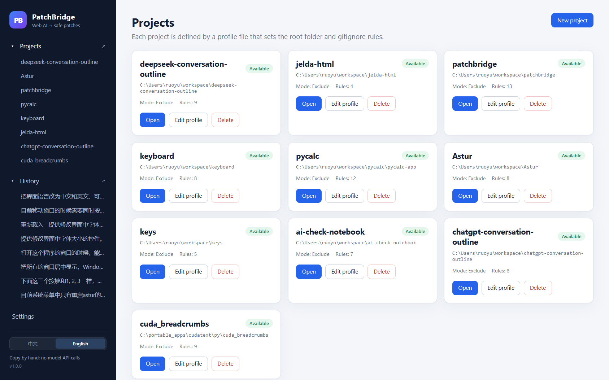
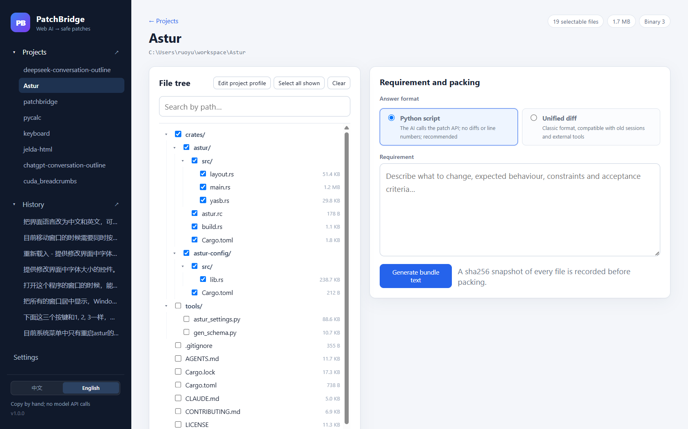
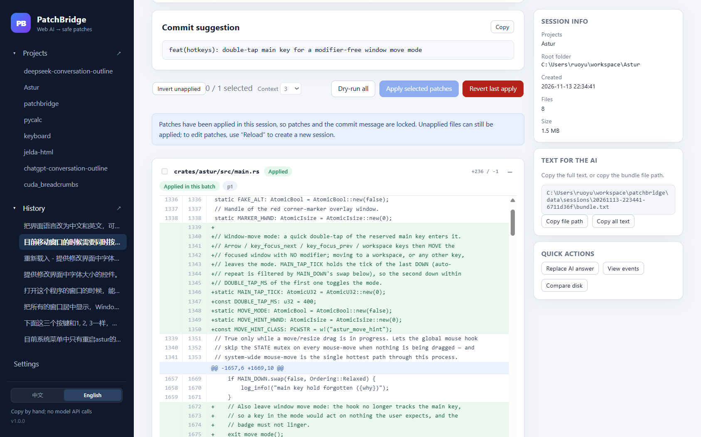

# PatchBridge

**English** | [中文](#中文)





Turn manually copied Web AI answers into reviewed, backed-up, reversible code patches.

PatchBridge is a **local** tool. It calls no model API and performs no browser automation.
You copy text between PatchBridge and a Web AI; PatchBridge collects context, bundles it,
parses the answer, previews diffs, dry-runs, backs up, applies, and reverts.

> Automated DeepSeek input is optional and requires the companion browser extension:
> <https://github.com/ruoyu0088/deepseek-conversation-outline>

## Quick start

### Windows

Requirements: Python 3.11+ and Git on `PATH`.

```bat
python -m pip install -r requirements.txt
start.bat
```

Double-click `start.bat` after the one-time dependency install. The server listens on
`127.0.0.1:8765`, tries the next ports if it is busy, and opens the browser.

`start.bat` does **not** install packages automatically. If a dependency is missing,
`start.py` lists the missing package(s), prints the install command, and waits for Enter.

### Other platforms

```bash
python -m pip install -r requirements.txt
PYTHONPATH=src python -m patchbridge --open
```

### Interface language

Use the **中文 / English** switch at the bottom of the sidebar. The choice is saved in the browser;
the page reloads so the UI, backend diagnostics, and generated prompts all use the same language.
The default is Chinese, and `Accept-Language` is honoured by the API.

### Dependencies

- Python 3.11+.
- FastAPI, Uvicorn, pathspec, charset-normalizer (see `requirements.txt`).
- Git 2.x: applying patches requires the project to be a git repository.
- Optional: [mpatch](https://github.com/Romelium/mpatch) 1.8+ for fuzzy application after the
  strict engine fails. PatchBridge checks the configured path, `PATH`, and
  `C:\portable_apps\bin\mpatch.exe`.
- No Node.js runtime is required; Vue 3 is vendored in `web/vendor/`.

## Workflow

1. **Project**: create a profile with the project root and gitignore-style file rules.
2. **Select files**: search and check files or whole directories. Binary files, `.git/`, and
   files above the size limit are excluded; excluded binary paths are listed separately.
3. **Answer format**: choose **Python script** (default, recommended) or **Unified diff** before
   bundling. Python mode calls a small patch SDK and never asks the AI to calculate line numbers
   or copy exact context; diff mode remains compatible with older sessions and external tools.
4. **Bundle**: enter the requirement and generate the bundle. You can copy the full text or copy
   the absolute path of `bundle.txt`.
5. **Ask the AI**: the built-in prompt asks for an explanation, a commit suggestion, and either a
   Python script or file patches.
6. **Parse and execute**: paste the complete AI answer back. Python mode extracts the script and
   executes it in an in-memory workspace; diff mode extracts unified diffs. Nothing on disk changes
   until you apply. The script page has a line-number gutter; log entries and error positions link
   to their script line. Headings such as `Commit suggestion` and `Python patch script` work with
   or without a leading `#`.
7. **Review**: inspect per-file side-by-side diffs with adjustable context, status badges, and
   dry-run results. Patches and the commit message remain editable. For indentation-only conflicts,
   use one-click alignment; the built-in editor remains available for manual fixes.
8. **Fuzzy fallback**: when the strict engine fails, PatchBridge aligns pure indentation differences
   and calls mpatch in a **disposable copy**. The resulting `git diff` is shown as the final patch
   and revalidated by the strict engine before apply. If mpatch still fails, PatchBridge generates
   an “AI repair request” (full file for small files, ±30 lines around the failure for large files).
9. **Apply**: select files and apply partially or fully; affected files are backed up first. All
   selected files are applied in one transaction.
10. **Revert**: strict LIFO, restoring modified files and deleting files created by the patch.
11. **History**: plain-text sessions, index rebuild, archive, export, reload, and disk comparison.

See [docs/USER_GUIDE.en.md](docs/USER_GUIDE.en.md) for details.

## Examples

- [examples/example.profile](examples/example.profile)
- [examples/demo-project](examples/demo-project)
- [examples/sample-session](examples/sample-session): a desensitized parsed session with
  `bundle.txt`, `answer.md`, `parsed.json`, `patches/`, and `events.jsonl`.

## Data directory

Defaults to `data/` under the project root; override with `PATCHBRIDGE_DATA_DIR`:

```text
data/
  settings.json
  index.json
  profiles/*.profile
  sessions/<id>/...
    script/script.py|report.json
    mpatch/<patch_id>.json|.patch|.repair.md
  sessions/<id>.zip
  backups/<id>/<apply_id>/...
  tmp/
  logs/app.log
```

Everything is plain text, JSON, or JSONL; there is no database. `data/` is gitignored.

## Tests

```bash
python -m pytest
```

The suite covers profile rules, bundle marker conflicts, tolerant parsing, diff application,
CRLF/BOM preservation, partial apply, LIFO revert, index rebuild, archives, malicious zip files,
exported patch application on a clean git copy, mpatch copy isolation/fuzzy application/repair
requests, and Python-mode bundling, parsing, in-memory execution, expected-count mismatches,
path scope, new files, syntax errors, line links, and API flows. See
[docs/ACCEPTANCE_MATRIX.en.md](docs/ACCEPTANCE_MATRIX.en.md).

## Important limitations

- Text patches only. File deletion, rename, mode changes, and binary patches are rejected.
- Python mode can edit selected files or create profile-visible new files. It cannot delete, rename,
  or overwrite a whole file. Scripts run in a restricted thread; a timeout discards that run's
  in-memory workspace.
- v1 supports file-level selection only, not hunk-level selection.
- Applying patches requires a git repository (the internal line-level engine writes bytes safely;
  it does not use `git apply` to write the worktree).
- mpatch is optional. Without it, PatchBridge uses the strict engine and indentation alignment, then
  produces a repair request on failure. mpatch reads its copy as UTF-8; PatchBridge normalizes the
  disposable copy to UTF-8/LF, and the final patch is written back with the original encoding/BOM.
- The server listens on loopback only and has no login or multi-user support.
- After the backup retention period, the post-apply vs current-disk diff may be unavailable.
- The Python script sandbox is a convenience boundary, not a hardened security sandbox. Only run
  answers you trust.

Full design decisions and platform notes: [docs/DESIGN.en.md](docs/DESIGN.en.md).

## Release

Tags matching `v*` trigger `.github/workflows/release.yml`. The workflow validates the tag against
the project version, runs tests, builds `PatchBridge-<version>.zip`, and publishes a GitHub Release
with bilingual notes. The archive contains the source, web UI, docs, examples, tests, launcher, and
requirements. Users still need Python 3.11+ and Git installed locally.

## Repository layout

```text
src/patchbridge/   backend and core logic
web/                no-build Vue UI
tests/              automated tests
examples/           sample profile, demo project, desensitized session
docs/               design, user guide, acceptance matrix (Chinese and English)
start.bat           Windows double-click launcher
start.py            dependency check + launcher
requirements.txt    runtime dependencies
```

---

## 中文

把 Web 版 AI 的回答安全地变成可审阅、可回滚的代码补丁。

PatchBridge 是一个**本地**工具：它不调用任何模型 API，也不做浏览器自动化。你负责在
PatchBridge 和 Web AI 之间手工复制文本；PatchBridge 负责收集上下文、打包、解析回答、
预览 diff、dry-run、备份、应用和撤回。

> 自动输入 DeepSeek 是可选功能，需要配套浏览器插件：
> <https://github.com/ruoyu0088/deepseek-conversation-outline>

### 快速开始

#### Windows

要求：Python 3.11+，Git 已在 `PATH` 中。

```bat
python -m pip install -r requirements.txt
start.bat
```

首次安装依赖后，双击 `start.bat` 即可。服务器默认监听 `127.0.0.1:8765`，端口被占用时
自动尝试后续端口，并打开浏览器。

`start.bat` **不会**自动安装依赖。缺少依赖时，`start.py` 会列出缺失的包、打印安装命令，
并等待回车后关闭窗口。

#### 其他平台

```bash
python -m pip install -r requirements.txt
PYTHONPATH=src python -m patchbridge --open
```

### 界面语言

侧边栏底部可切换 **中文 / English**。选择保存在浏览器中，切换后页面会重新加载，使界面、后端诊断和生成的提示词使用同一语言。默认中文；API 也支持 `Accept-Language`。

### 依赖

- Python 3.11+。
- FastAPI、Uvicorn、pathspec、charset-normalizer（见 `requirements.txt`）。
- Git 2.x：应用补丁要求工程是 git 仓库。
- 可选：[mpatch](https://github.com/Romelium/mpatch) 1.8+，严格引擎失败后的模糊应用。
  PatchBridge 会依次检查设置路径、`PATH` 和 `C:\portable_apps\bin\mpatch.exe`。
- 不需要 Node.js 运行时；Vue 3 已内置在 `web/vendor/`。

### 工作流

1. **工程**：新建 profile，指定项目根目录和 gitignore 风格的文件范围。
2. **勾选文件**：搜索、勾选文件或目录；二进制文件、`.git/`、超过阈值的大文件默认排除。被排除的二进制路径会单独列出。
3. **选择回答格式**：打包前选择 **Python 脚本**（默认、推荐）或 **Unified diff**。Python 模式让 AI 调用内置补丁 API，不自己算行号或复制上下文；diff 模式兼容旧会话和外部工具。
4. **打包**：输入需求，生成打包文本。可复制完整文本，也可复制 `bundle.txt` 的绝对路径。
5. **交给 AI**：内置提示词要求 AI 按“修改说明 / Commit 建议 / Python 脚本（或文件补丁）”回答。
6. **解析与执行**：把 AI 输出的全部内容粘贴回工具。Python 模式自动提取脚本并在内存工作区执行，生成候选补丁；diff 模式自动寻找 unified diff。应用前真实文件不会改变。Python 脚本页带行号栏，日志和错误位置可点击跳到对应脚本行；`Commit 建议`、`Python 补丁脚本` 等标题可以不带 `#`。
7. **审阅**：逐文件查看左右并排 diff（上下文行数可调）、状态和 dry-run 结果；补丁和 commit 文本可编辑。纯缩进冲突可一键对齐，内置编辑器仍保留用于手工修复。
8. **模糊回退**：严格引擎失败时，先自动对齐纯缩进，再在**临时副本**中调用 mpatch；成功后展示由副本 `git diff` 生成的最终补丁，应用前仍由严格引擎校验。仍失败则生成“AI 修正请求”（小文件附全文，大文件附失败位置附近 ±30 行）。
9. **应用**：勾选文件，支持部分或全部应用；应用前自动备份，所有选中文件在同一个事务中写入。
10. **撤回**：严格 LIFO，按备份恢复修改过的文件，删除补丁新增的文件。
11. **历史**：纯文本会话、索引重建、归档、导出、重新载入、磁盘差异比较。

详细步骤见 [docs/USER_GUIDE.md](docs/USER_GUIDE.md)（英文：[docs/USER_GUIDE.en.md](docs/USER_GUIDE.en.md)）。

### 示例

- [examples/example.profile](examples/example.profile)
- [examples/demo-project](examples/demo-project)
- [examples/sample-session](examples/sample-session)：脱敏的已解析会话，可直接查看 `bundle.txt`、`answer.md`、`parsed.json`、`patches/` 和 `events.jsonl`。

### 数据目录

默认在项目根目录的 `data/`，可用 `PATCHBRIDGE_DATA_DIR` 覆盖：

```text
data/
  settings.json
  index.json
  profiles/*.profile
  sessions/<id>/...
    script/script.py|report.json
    mpatch/<patch_id>.json|.patch|.repair.md
  sessions/<id>.zip
  backups/<id>/<apply_id>/...
  tmp/
  logs/app.log
```

全部使用纯文本/JSON/JSONL，不使用数据库。`data/` 已加入 `.gitignore`。

### 测试

```bash
python -m pytest
```

测试覆盖 profile 规则、打包冲突、解析容错、diff 应用、CRLF/BOM、部分应用、LIFO 撤回、索引重建、归档、恶意 zip、导出补丁在干净 git 副本上的应用，以及 mpatch 副本隔离、模糊应用、失败修正请求和编码保持。Python 模式另有打包头、脚本解析、内存执行、预期数不匹配、越界路径、新建文件、语法错误、行号关联和 API 流程测试。逐条验收映射见 [docs/ACCEPTANCE_MATRIX.md](docs/ACCEPTANCE_MATRIX.md)。

### 重要限制

- 只处理文本补丁；删除文件、重命名、文件权限修改、二进制补丁会被拒绝。
- Python 模式只能修改本次选中的文件，或新建 profile 可见范围内尚不存在的文件；不能删除/重命名，也不能整文件覆盖。脚本在受限线程中运行，超时会丢弃该次内存工作区。
- v1 只支持文件级勾选，不支持 hunk 级勾选。
- 应用补丁要求工程是 git 仓库（内部使用字节安全的行级引擎，不依赖 `git apply` 写盘）。
- mpatch 是可选外部依赖；未安装时只使用严格引擎和缩进对齐，失败后直接生成修正请求。mpatch 命令行按 UTF-8 读取副本；PatchBridge 会先把副本规范化为 UTF-8/LF，最终仍由严格引擎按原编码/BOM 写回。
- 工具只监听本机回环地址，没有登录/多用户机制。
- 备份保留期过后，“应用后 vs 当前磁盘”的内容差异可能不可用。
- Python 脚本沙箱是便利性边界，不是强安全沙箱；只运行你信任的回答。

完整设计决策与平台说明见 [docs/DESIGN.md](docs/DESIGN.md)（英文：[docs/DESIGN.en.md](docs/DESIGN.en.md)）。

### 发布

`v*` 标签会触发 `.github/workflows/release.yml`：校验标签与项目版本、运行测试、构建
`PatchBridge-<version>.zip`，并发布带中英文说明的 GitHub Release。压缩包包含源码、Web UI、
文档、示例、测试、启动脚本和依赖清单。用户本机仍需安装 Python 3.11+ 和 Git。

### 目录

```text
src/patchbridge/   后端与核心逻辑
web/               无构建 Vue 界面
tests/             自动化测试
examples/          示例 profile、demo 工程、脱敏会话
docs/              设计、用户指南、验收矩阵（中英文）
start.bat          Windows 双击启动
start.py           依赖检查 + 启动
requirements.txt   运行依赖
```
